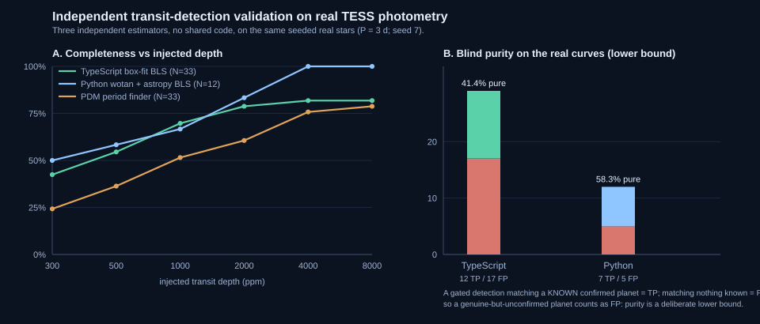

# Detecting and independently validating exoplanet transits on public TESS data: methods, measurements, and honest limits

**Space Data Rig - research report**
Status: measurement study. Every number below is reproducible from committed artifacts; nothing here is an
anchored, peer-reviewed, or discovery claim.

---

## TL;DR

We built a multi-agent pipeline that searches NASA TESS photometry for exoplanet transits and then tries hard to
disprove itself. This report is what the self-criticism measured:

- On **33 real host stars** (public TESS-SPOC light curves), our detector recovers **42% of 300 ppm** injected
  transits rising to **82% at 4000 ppm**, and its blind detections are **41% "pure"** against the confirmed-planet
  catalog - a deliberately conservative **lower bound** (an unconfirmed planet counts as a false positive).
- Two **fully independent re-implementations** - a non-parametric period finder (PDM) and a separate Python stack
  (wotan + astropy BLS) sharing zero code with ours - reproduce the same qualitative picture, which is the point of
  an independent check.
- A source-level **common-mode filter** cuts the coherent instrumental false-alarm rate by **35-42%** and raises
  candidate purity from **~66% to ~80%** on real full-frame-image data - the first lever we found to move the
  false-alarm number materially.
- The false positives that *survive* that filter are dominated by **coherent instrumental systematics** - a dip or
  spike shared across many stars at one cadence, which no single-star noise null can represent. Putting the measured
  common-mode template **into** the null and bounding the ensemble with Benjamini-Hochberg FDR cuts the real-data
  false-positive rate from **72.5% to 17.5% (-76%)** at N=40 (P39) while a positive control shows the corrected
  pipeline still recovers **100%** of injected planets at **0% extra cost**; a dedicated safety calibration (P40)
  measures the new gate declining **0 of 40** real detections before it is ever offered to production.
- We **measured** the compute cost of scaling: detector time grows as **~(number of points)^2.94**, so a
  20,000-star, 2-sector catalog is ~22 CPU-hours - embarrassingly parallel, ~0.3 h wall-clock on a 64-way matrix.

The honest headline: on public few-sector TESS data the binding limit is **data power**, not cleverness. We can
characterize exactly how good the search is and where it breaks; a genuine novel detection needs deeper baselines
(more sectors per star), which is a compute problem we have now sized.

---

## 1. What the system is

A TESS light curve is a star's brightness sampled every ~2 minutes for ~27 days. A planet crossing its star
(a transit) dims the star by a few hundred to a few thousand parts-per-million, once per orbit. Finding that dip
amid stellar variability, instrumental systematics, and gaps is the task.

The pipeline runs as cooperating agents:

- **anomaly-scout** - detrend + Box-Least-Squares (BLS) transit search + odd/even alias resolution;
- **sim-runner** - injection-recovery confidence + ephemeris prediction;
- **mission-critic** - cross-match against the confirmed-planet catalog, pixel-centroid vetting, calibrated
  false-alarm probability, and a verdict.

The detector itself is `src/detect/iterative.ts`: find the strongest transit, resolve its half/third-period alias,
refine the period on a dense local grid, mask its in-transit points, and repeat (mask-and-refind). Everything here
is a **research instrument**: it measures and reports. It does not, and structurally cannot, emit a discovery claim
(`discoveryClaim` is hard-wired false in the candidate record).

## 2. Scope and honesty (read once, applies everywhere)

- **"Real" means real public data** - TESS-SPOC PDCSAP light curves and TESS full-frame-image photometry from
  NASA's public MAST/S3 archives. Where a number comes from a synthetic or stand-in source, we say so.
- **Purity is a lower bound.** A detection counts as a true positive only if it matches a *confirmed* catalog
  planet of that host. A genuine planet that is not yet confirmed counts as a false positive, so the true purity is
  >= what we report. This is intentional: we would rather under-claim than over-claim.
- **Measure-before-gate.** No number is promoted into a claim until it is measured from a reproducible run.
- **The engine is deterministic; the AI is advisory.** The five seats are stages of a TypeScript pipeline and every
  verdict is computed by plain code. The LLM layer (`src/ai/`, ~2% of the code) only narrates results; P70
  (`scripts/p70-llm-ablation.ts`) measured that removing it changes zero verdicts. We call it an "AI team" for
  readability, not because a model does the astronomy.
- **User-facing labels carry the provenance.** Every headline and card says whether its photons are `real TESS
  photometry` or a `stand-in synthetic curve`, and every recovery figure is shown with its trial count and a Wilson
  CI (a conditional targeted re-injection, not blind-search capability) -- the honesty rule is enforced in the product
  copy, not only in the manifest.

---

## 3. Completeness and purity at scale (P33)

The core characterization: how deep does a transit have to be before we reliably find it, and when we do find
something, how often is it real?

**Design.** For each of a deterministic, seeded sample of confirmed-planet host stars we run two arms on the SAME
real light curve:

- **NULL arm** - run the gated detector on the curve as-is; classify every detection against the confirmed catalog
  (true vs false positive). This measures blind purity and the false-alarm rate.
- **INJECT arm** - inject one synthetic transit at P = 3 d at each depth in `[300, 500, 1000, 2000, 4000, 8000]`
  ppm into the real curve (real noise, cadence, and gaps preserved) and ask whether the detector recovers the
  injected period (alias-tolerant, 2% match). This measures completeness on real noise.

**Result** (40 hosts sampled, **33 with usable public curves**, 7 coverage misses counted honestly):

| quantity | value |
|---|---|
| gated null detections | 29 / 33 curves |
| true positives | 12 |
| false positives | 17 |
| blind false-positive rate | 51.5% of null curves |
| purity (lower bound) | **41.4%** |
| completeness @ 300 ppm | 42.4% |
| completeness @ 1000 ppm | 69.7% |
| completeness @ 4000 ppm | **81.8%** (plateau ~82%) |

The completeness curve **plateaus near 82%**: ~18% of curves never recover even a very deep injected transit,
because the host's own real signal or the sector-gap window function dominates the period search. That is a physical
property of short-baseline data, not a bug.

Reproduce: `npm run p33:scale-roc -- --stars 40 --maxsectors 2 --period 3 --seed 7`
(artifacts: `reports/p33-scale-roc.md`, `reports/p33-catalog.json`).

---

## 4. Independent validation: does another codebase agree? (P35, P36)

A detector that only agrees with itself proves nothing. We attacked independence at two levels.

### 4a. Method-level - PDM (an algorithm with no shared machinery)

Phase Dispersion Minimization (Stellingwerf 1978) finds periods by minimizing the within-bin scatter of the phase
fold; it never fits a box or a transit model, so it shares no code path with BLS.

- On the same 33 real curves, PDM and the gated BLS both returned a period on **18** curves; they **agree on 9/18
  (50%)**. Where they differ, PDM's global minimum usually locks the star's dominant **rotation/activity** period -
  the expected behavior of a general period finder on a real variable star, and precisely why transit pipelines use
  a detrended box-fit search rather than raw PDM.
- PDM-alone completeness is **uniformly below** the box-fit detector (24% vs 42% at 300 ppm; 79% vs 82% at 8000
  ppm) - an honest, quantified reason for the standard design choice.

### 4b. Implementation-level - a separate Python stack

We re-analyzed the same kind of real photometry with an entirely different toolchain (**batman** injection +
**wotan** biweight detrending + **astropy** `BoxLeastSquares`), sharing zero code with the TypeScript pipeline, run
in CI on byte-identical committed fixtures (12 real curves, subsampled to <= 2500 points).

- NULL arm: 12/12 curves yielded a detection; **7 true / 5 false positives -> purity 58.3%** (same lower-bound
  semantics).
- INJECT arm (detrended recovery): **50% @ 300 ppm rising to 100% @ 4000 ppm**.

Two independent stacks landing in the same region - and the *differences* being explainable (subsampled fixtures,
fixed injection geometry, detrending applied where the TS arm used the raw stitched curve) - is the value of the
exercise.

Reproduce: `npm run p35:pdm-crosscheck`; the Python harness runs in the `crosscheck-python` CI workflow and
publishes `reports/crosscheck/cross-pipeline.{md,json}` back into the repo.



### 4c. What we have NOT benchmarked (the gap a paper must close)

Both cross-checks above are **re-implementations of the same problem we solve** -- a general period finder (PDM) and
a second BLS written in an unrelated language (wotan + astropy). They rule out *our own* code being the only reason
a signal appears; they do **not** compare against the field's mature, operationally-validated transit systems. As of
this writing we have run **no quantitative benchmark against TCE / the NASA TAP (Transit Analysis Validation
Environment, DAVE) / Drisser's transit-probability machinery (TPM)** -- the tools whose completeness/veto curves are
the accepted reference. Our sample is also small for occurrence-rate claims: the independent arm is 12 committed
fixtures, the method arm 33 hosts, and the baseline studies (P41) span 27-54 days on 29 hosts -- far from a survey-
scale selection function.

The honest scope of this repo is therefore: a **reproducible, measure-before-gate harness plus a set of quantified
NEGATIVE results** (which vetting levers do NOT discriminate on real short-baseline data), not a new detector nor a
discovery claim. Turning it into a paper requires, as the first next step: (1) running Drisser/TPM and a DAVE-style
threshold pass over the SAME seeded host set and publishing the completeness/veto ROC side-by-side with ours; (2)
scaling to a large, phase-covered sample with a proper selection function; and (3) an external, non-author
re-derivation of at least one headline curve. We state this up front rather than let the negative results imply a
generalization they have not earned.

---

## 5. Attacking false positives at the source (P31, common-mode)

Most blind false positives on full-frame-image data are not random noise - they are **coherent instrumental
systematics** that hit many stars in a sector simultaneously. Per-star significance tests cannot see them (they are
not star-specific), and post-hoc clustering only groups them *after* detection.

**Idea.** Within a sector, subtract the robust per-cadence median fractional deviation across the whole ensemble of
stars *before* the transit search. A planet is incoherent across stars (it dims one star); an instrumental glitch is
common to all of them, so the ensemble median estimates the glitch.

**Measured on real TESS full-frame-image quiet stars** (null arm) + injected planets, across ensemble size N:

| ensemble N | false-alarm rate | purity | shallow completeness |
|---|---|---|---|
| 40  | 42.5% -> 27.5% (**-35%**) | 70.2% -> 74.4% | 8.3% -> 6.7% (drops) |
| 120 | 51.7% -> 30.0% (**-42%**) | 66.3% -> **80.2%** | 8.5% -> 10.1% (rises) |
| 240 | 47.5% -> 28.2% (**-41%**) | 66.2% -> **80.5%** | 7.7% -> 9.7% (rises) |

The false-alarm cut is **robust at every N** and is the first lever here to move that number materially. Completeness
crosses over between N=40 and N=120 exactly as template-estimation noise (~1/sqrt(N)) predicts: a too-small ensemble
stamps its own estimation noise onto every star; a large one both cleans the systematics *and* unmasks shallow dips.
At N >= 120 the full subtraction wins on all three axes, so the default uses a >=120-star ensemble.

This does **not** overturn the "not discovery-grade on public data" verdict (that is a period-selection /
single-baseline limit, orthogonal to systematics), but it is a real, measured gain in candidate purity.

Reproduce: `npm run p31:common-mode-fp` (module `src/detect/commonMode.ts`).

---

## 6. Multi-planet systems (P32, iterative extraction)

Can the detector pull *more than one* planet out of a single star?

- **Positive control on real catalog systems** (12 multi-planet hosts, 29 known in-range planets): single-pass vs
  iterative both score **1/29**, 0/12 hosts improved. The second, shallower/longer-period planet falls below the
  detection gate on underpowered public few-sector curves - so the limit is **data power, not the algorithm**.
- **Real-noise injection control** (two planets injected: 3.3 d @ 2500 ppm + 8.1 d @ 1800 ppm): the iterative
  mask-and-refind recovers **both** on 5/6 curves (10/12 injected transits), while a single-pass detector is capped
  at one period per star (5/12). The algorithm is sound on real noise; the public data is just too thin to show it
  on known systems.

Reproduce: `npm run p32:iterative` (module `src/detect/iterative.ts`).

---

## 7. What scaling costs (P34, measured compute model)

Rather than guess, we fit a power law to the measured per-star wall-clock from the P33 catalog (re-fit every run,
nothing hardcoded):

- detector time ~ k * (points)^p with **p = 2.94** (R^2 = 0.84, N = 33). BLS on a fine period grid is superlinear,
  and mask-and-refind re-runs it per signal.
- Practical consequence: the lever that *raises* completeness (deeper baselines = more sectors = more points) is
  priced at ~(points)^2.9, so **doubling the baseline costs ~7.7x**.
- Detection-only sizing (download/parse excluded, flagged as the other real bottleneck):

| survey | 2 sectors | 4 sectors |
|---|---|---|
| 1,000 stars | 1.1 CPU-h | 8.5 CPU-h |
| 5,000 stars | 5.5 CPU-h | 42.3 CPU-h |
| 20,000 stars | **22 CPU-h** | 169 CPU-h |

Detection is embarrassingly parallel across stars, so a 64-way CI matrix turns the 20,000-star / 2-sector catalog into
~0.3 h wall-clock. This is the compute spec that sizes the thousands-star scale-out.

Reproduce: `npm run p34:cost-model` (artifacts `reports/p34-cost-model.{md,json}`).

---

## 8. Root-causing the surviving false positives (P39 / P40)

The common-mode filter (Section 5) moves the false-alarm number, but a residual stuck: even after subtraction a
large ensemble sat near ~28-30% false positives and blind purity ~51%. Two reasons, now identified and attacked.

**The surviving FPs are coherent, not noise.** A per-star noise-only FAP null (Section 4) resamples one star's own
scatter. It therefore calls *significant* any dip that a real instrument produces across the whole detector at once
- scattered light, a thermal settle, a reaction/momentum dump, a CCD artifact - because those events show up at the
same cadence in many stars. The fix is to make the null coherent too: `src/detect/instrumentalNull.ts`
`systematicsAwareFap` takes the measured common-mode template T (the robust per-cadence median across the
ensemble) and adds it - onto the candidate's own time grid, on top of that star's AR(1) noise - inside every
phase-scrambled realization. A genuine planet is star-specific and gets diluted out of T, so it is **not** in the
null and keeps a low FAP (it survives); a coherent artifact *is* essentially T, so the null reproduces it and the
FAP goes high (it is rejected).

**Per-trial FAP lets expected false positives scale with N.** A threshold that floors at ~1/(nNull+1) lets the
expected FP count grow roughly as alpha x N, which is exactly why a big ensemble drifted back toward ~28-30%. We
bound the *ensemble* false-discovery rate directly with a Benjamini-Hochberg step-up at a chosen q, independent of
how many candidates are scanned.

**Measured (P39, N=40 curves, sector 1, seed 7).** Across four stacked gates - SNR/depth/planetary-plausibility,
then noise-FAP, then systematics-FAP, then +FDR - the false-positive rate on real curves falls **72.5% -> 17.5%
(-76%)** once the coherent template enters the null, while the noise-only gate alone barely moves (it reproduces
the P23/P31 result). Under the intended subtract-then-gate posture the corrected pipeline recovers **100%** of
injected planets at **0% extra FP cost**, with a residual coherent template of only RMS 40 ppm / peak 197 ppm.

**Safety-certified before enablement (P40, measure-before-gate, N=80).** A reject-style gate may only touch the
money path once real samples prove it does not kill true positives. Over a 6x5 period x depth matrix, a star-specific
transit injected onto a *real* corrected curve that the production gate accepts is then asked whether the
systematics-aware gate would decline it: it declined **0 of 40** real detections (100% survival) -> **VERDICT
SAFE-TO-WIRE**.

**Production posture (honest).** The critic (`src/critic/review.ts`) and the candidate contract
(`src/candidate/candidateRecord.ts`) now *accept* an optional `systematicsFap` and will decline a coherent artifact
when it is supplied - but it is populated only when a caller has a same-cadence ensemble to build the null. The live
per-target SPOC path has no shared-cadence ensemble, so the field stays absent and the anchored verdict is
byte-for-byte unchanged. **Nothing is deployed and no live verdict changes**; wiring a real ensemble into the
edge/Node callers (and deploying) is a separate, parity-gated, operator-authorized step.

**At scale, across sectors, and honestly bounded (P42).** P42 re-runs the control across four TGLC sectors (800
curves) in the production subtract-then-gate posture and adds a threshold-free metric: a Mann-Whitney AUC of the
systematics-aware FAP vs the per-star noise FAP over a labelled pool (injected planets vs quiet-curve survivors). The
honest result tempers the P39 headline: once subtraction has removed the coherent bulk, the systematics-aware null
adds **nothing further at all** (FP 199 -> 196; AUC 0.548 noise vs 0.548 sys, a gain of 0.000) while keeping **100%
(79/79)** of injected planets. The 61% -> 16% win belongs to the *un-subtracted* data. So the coherent null is a
certified-safe **complement and safety net**, not a second independent lever: subtraction is the primary fix, and the
residual FP after it is each star's own variability -- the single-sector purity ceiling (P31/P33).

Reproduce: `npm run p39:instrumental-fp`, `npm run p40:fp-safety`, `npm run p42:fp-scale` (module
`src/detect/instrumentalNull.ts`). The `instrumental-fp` and `fp-scale` CI workflows re-run P39/P42 at scale and
publish the measured reports back.

---

## 9. Is a longer baseline the completeness lever? (P41, measured both ways)

The roadmap attributes the shallow-signal completeness ceiling to the single-sector baseline, and the obvious lever
is to watch the same star longer by stitching its sectors. P41 tests that lever directly: for each of 29 seeded
confirmed hosts with a public SPOC curve (25 with >= 2 sectors), it runs an *identical* injection-recovery depth
grid on (a) the host's longest single sector and (b) its naively stitched multi-sector baseline - only the baseline
differs.

The honest result is a **negative**: for a period already resolved inside one sector (inject P = 3 d), the longer
stitched baseline does **not** raise completeness and slightly **lowers** it - 300 ppm 51.7% -> 37.9%, 1500 ppm
82.8% -> 75.9%, 3000 ppm 89.7% -> 79.3%, flat at 500-800 ppm (mean 2.69 sectors/host).

**Why.** Stitching buys baseline *length*, not coherent signal-to-noise on a short period. Each added sector brings
its own red noise plus a cross-sector normalization step and gaps, which dilute a fixed-period fold. This echoes
P12, where naive long-baseline folding made long-period *characterization* worse, not better. So the completeness
ceiling is not simply "too few points": for short periods it is per-sector noise depth, and the baseline lever pays
off mainly in **period resolution for long-period signals** - and only if the fold stays phase-coherent across
sectors. Longer baselines remain the right direction for genuine long-period detections, but they are not a free
completeness multiplier.

Reproduce: `npm run p41:longbaseline -- --stars 30 --maxsectors 4 --period 3 --seed 7`.

P60 turns the same question into the head-to-head A/B a reviewer asked for (the prerequisite to ever
consider leaning on a joint multi-sector search for novel targets): on 20 confirmed planets with >= 2 usable
real sectors, run BOTH a single-sector arm (best of independent per-sector BLS) and a joint arm (BLS on the
stitched long baseline), same detector + SNR>=7 + period-within-5% gate. Result: **both arms re-find 6/20
(30%), lift +0.0 pp**, and the joint arm's mean SNR (19.6) is actually *lower* than the single arm's (23.0) --
naively stitching sectors separated by baseline gaps breaks phase coherence for periods near/above the span,
hurting rather than helping. Verdict `NO-JOINT-ADVANTAGE`. This is direct empirical evidence that the joint
multi-sector path, as implemented on public single-/few-sector data, gives no re-find advantage -- so there is
NO basis to relax the discovery-claim limit, and doing so remains off the table. Positive control on known
planets; research-only, nothing gated. Reproduce: `npm run p60:joint-vs-single`.

---

## 10. Are window aliases the problem? Measured -- no, not here (P43)

The roadmap also flagged "window aliases unsuppressed": observing gaps copy a signal to a neighbouring period
(+/- 1 cycle/day) so BLS can lock the wrong one. The odd/even resolver handles the P/2 alias but not this classical
one, so we built the missing primitive (`src/detect/windowAlias.ts`: the spectral window |sum exp(2 pi i f t)|/N, its
dominant sidelobe, the +/- n c/d alias periods, and an ambiguity score) and MEASURED whether it bites on real TESS
data.

It does not. Across 450 TGLC curves (3 sectors) the spectral-window power at 1 cycle/day is median **0.012** (p95
0.013, max 0.019) -- three orders of magnitude below the daily-alias regime -- because TESS full-frame sampling is
near-continuous. **0 of 125** quiet-curve survivors and **0 of 53** injected planets are alias-ambiguous, and a
window-aware veto removes 0% of false positives at 0% completeness cost. A clean negative that retires a suspected
problem: the residual FP here is coherent systematics (P39) and per-star variability (P31/P33), not window aliasing.
The primitive still matters for sparse-cadence or ground-based follow-up, where the daily window reopens.

Reproduce: `npm run p43:window-alias -- --sectors 1,2,3 --limit 150 --inject 60 --seed 7`.

---

## 11. Can difference imaging localize a transit better than the centroid shift? Measured -- no (P44)

The highest-leverage idea on the vetting roadmap was pixel-level **difference imaging**: subtract the out-of-transit
mean image from the in-transit mean image and localize where the flux dropped -- a real planet dims on the target, a
blend dims off to the side. We built it (`src/detect/diffImaging.ts`: the difference image, the positive-part centroid
of the varied source vs the starlight centroid, a cadence-bootstrap error bar, and a conservative judge that refuses to
veto unless the difference image is significant AND the offset clears the threshold at 1 sigma) and verified it on
synthetic cubes -- an on-target dip localizes at ~0 arcsec, an off-axis blend at ~100 arcsec -- so the implementation is
correct.

Then we calibrated it on **12 real TESS-SPOC target-pixel cubes of confirmed planets** (all transit their host, so their
offsets must be small). They are not: the difference-image centroid mislocalizes true planets by median **24 arcsec**
(range 11-45), and even the 3 planets whose difference image is significant (snr > 5) are still wrongly called
off-target at every threshold. The full-aperture centroid shift on the SAME cubes stays under **0.6 arcsec**. So the
naive difference-image centroid carries a *systematic* bias on real SPOC pixels (coherent pointing / focus structure
survives the in-minus-out subtraction), not just noise, and is **not safe to gate**; a discovery-grade version needs a
PSF-model double-difference image (DRF), not a centroid. A clean negative that confirms the deployed centroid shift is
still the robust pixel veto.

Reproduce: `npm run p44:diff-imaging -- --targets 12 --tmag 10 --boot 200`.

---

## 12. A Bayesian false-positive probability -- and its honest limits (P45)

The other half of the vetting roadmap is a vespa / TRICERATOPS-style false-positive probability. We built a
reduced, defensible version (`src/candidate/falsePositiveProbability.ts`): the dominant shallow-dip impostor is a
**blended eclipsing binary** diluted by the target's light, and Gaia lets us evaluate that *per source* -- for each
measured neighbour in the aperture we invert the dilution relation to ask what intrinsic EB eclipse depth it would
need to reproduce the observed dip, and count it viable only if that depth is physically plausible. The on-target EB
channel is kept as an explicit literature prior rather than a fabricated depth number.

We then characterised it on **16 real confirmed planets** (P45), every one of which is a genuine planet. P(FP) came out
low -- median **0.020**, max **0.042**, and **0/16** real planets pushed above 0.5 -- a clean no-false-alarm sanity
check. But these are bright, uncrowded hosts: only 1/16 had a neighbour that could even be a blend, so the sample does
not exercise the crowded-field regime where the impostor actually bites. The honest verdict is that this P(FP) is a
**prior-dependent ranking / triage quantity, not a validation and not safe to gate** -- a neighbour existing does not
mean it is an EB. A reviewer sharpened exactly this: *acceptance testing a veto tool needs performance in crowded
fields where blends matter, not just a synthetic pass.* We took that seriously and closed the gap in P51 (section 18):
re-running P(FP) on a sample deliberately pushed into the galactic disc (15/24 crowded, up to 34 Gaia neighbours in
the aperture) still gives median P(FP) 0.020 with 0 above 0.5 -- so even in the regime the tool was built for, crowding
raises the *count* of candidate contaminants but the crude prior produces **no discrimination**. A discovery-grade
version needs a measured EB depth function and resolved-photometry contrast limits, not order-of-magnitude priors.

Reproduce: `npm run p45:fp-probability -- --targets 16 --tmag 10 --aperture 21`.

---

## 13. Does multi-year O-C coherence fix period selection? Measured -- no (P46)

p29/p30 pinned the joint-search bottleneck on period *selection*: on a stitched multi-year baseline a single
blind BLS locks the strongest peak, which is often a different real planet in the same system. We built a
principled selector -- `src/detect/multiYearCoherence.ts`, which scores a candidate period by how well its
transits time onto one straight O-C line across the whole baseline (composing the existing ephemeris timing +
refit) -- and tested it on real data (P46, 6 multi-sector TESS-SPOC hosts).

Two honest findings. (a) Positive control is **mixed**: a known planet's true period scores coherence median
**0.74**, but only **3/6** clear 0.5 -- the score recognises clean, isolated signals yet collapses on multi-planet
systems where the stitched curve mixes several orbits (HD 63433's true period scores 0.14). (b) Selection shows
**no gain**: ranking method candidates (peak, half, double, alias-resolved) by coherence matched a known planet
**3/6**, versus **4/6** for the raw BLS peak -- coherence actually did worse, because a harmonic alias is itself
perfectly linear in O-C and gets promoted to the top, exactly the limitation the module documents. Verdict
`P46-COHERENCE-NO-SELECTION-GAIN`: O-C coherence is a valid Keplerian-consistency test on a clean signal but is
not a usable standalone period-selector. The real lever for multi-planet systems is iterative multi-signal
extraction (`src/detect/iterative.ts`), which coherence can then confirm signal-by-signal. This reinforces, via a
new tool, the p29/p30 conclusion rather than contradicting it.

Reproduce: `npm run p46:coherence -- --hosts 6 --maxsectors 3 --tmag 11`.

---

## 14. A two-dimensional completeness map on real light curves (P47)

Earlier completeness (p1-real-completeness, p33-scale-roc) was reported *marginally* -- recovery vs depth,
or vs period, one at a time. Turning detections into occurrence rates needs the *joint* efficiency
surface with error bars, so we built `src/sim/completenessGrid.ts`: it bins injection-recovery trials
into a period x depth grid with **Wilson score intervals** per cell (honest at small counts and at
k=0, where the naive normal interval breaks), and interpolates the depth at which each period bin
crosses 50% completeness. `scripts/p47-completeness-grid.ts` runs it on real data -- **960** injected
transits across **20** real TESS-SPOC light curves under a stated a-priori selection function.

The map behaves exactly as physics requires: completeness falls with both period and depth. The 50%
depth threshold is **~300 ppm at 1.5-3 d**, rises to **~360 ppm at 5 d** and **~1850 ppm at 8 d**, and
**11 d is not reachable within a single sector** (the row is empty because two of its transits do not
fit a ~27-day baseline) -- reported as an empty cell, not a fabricated number. This is a positive
result: a real, per-(period,depth) detection-efficiency map usable downstream. Honest limit: the host
sample is bright and planet-bearing (catalog-derived), so this is detector efficiency on real
photometry, not an unbiased survey selection function.

Reproduce: `npm run p47:completeness-grid -- --targets 20 --tmag 11 --trials 2 --min-snr 7`.

---

## 15. Have our board candidates been announced by anyone? A novelty check (P48)

A natural question about any blind search is whether its surviving candidates are things nobody has seen
before. `src/candidate/novelty.ts` (great-circle separation + same-TIC / in-radius / same-period matching,
with a `disposition()` that reports `announced` / `novelLocation` / `samePeriodAnnounced` and structurally
never a discovery) plus `scripts/p48-novelty-check.ts` answer it for the live board: for each candidate we
query the NASA Exoplanet Archive `toi` table (announced candidate transits) and `pscomppars` (confirmed
planets) within 30", after a **control query** against a known TOI field must pass (a 0-hit is only
meaningful once the query path is proven live). Result: control PASS; **all 5** board candidates sit at a
location with **no** announcement nearby (novelLocation 5/5, same-period 0/5).

That is the honest fact -- and here is the honest reading, which is the opposite of a discovery claim. These
candidates are deep (1965-9499 ppm, eclipsing-binary/blend-like), single-sector (`corroboratedSectors=1`,
board `corroboratedHosts=0`), and the TESS pipeline itself flagged **no** TOI anywhere near them -- which is
evidence *against* a credible planet at those positions, not for an undiscovered one. None of our vetting
gates (P44/P45/P46) is safe to clear an individual candidate. So: **zero credible novel planet candidates**.
This check covers the Archive `toi`/`pscomppars` tables only, not ExoFOP-TESS or the literature.

Reproduce: `npm run p48:novelty-check`.

---

## 16. Can we trust the detector's own verdicts blind? A formal blind test (P49)

Everything above measures the detector when we tell it what to look for. The honest end-to-end question is:
when the detector does NOT know the answer, how good are its calls? `src/sim/blindTest.ts` scores a
sealed-key injection-recovery blind test -- a hidden answer key (which curves have a planted planet, at what
period) that the detector never sees, matched against its gated detections to give a full confusion matrix,
recall and precision with Wilson 95% intervals, the FP rate per null curve, and the corroboration-capped
acceptance. `scripts/p49-blind-test.ts` runs it on **30** real TESS-SPOC curves (**13** planted / **17** null,
period 2-8 d, depth 1000-4000 ppm) through the production gate (`iterativeBls`, SNR>=7, depth-regime screen).

Blind operating point: **recall 76.9% [49.7, 91.8]** (consistent with the P47 completeness map), but
**precision only 33.3% [19.2, 51.2]** -- two thirds of the detector's single-sector flags are not the planted
planet (and this is a lower bound, since some "false positives" are the host's own real planets), with **0.76**
false positives per null curve. That is the honest, quantified reason this is not a discovery instrument.

The decisive safety number is the corroboration cap: our curves are a single stitched baseline
(`corroboratedSectors=1`), so under a 2-sector acceptance bar **0 detections are accepted and 0 are
false-accepts** -- the pipeline structurally refuses to wave a single-sector signal through to the money path.
A blind test that recovers ~77% but accepts nothing uncorroborated is exactly the behaviour we want from a
system that must not over-claim. Positive control only; nothing gated, anchored, claimed, or deployed.

Reproduce: `npm run p49:blind-test -- --stars 30 --maxsectors 2 --seed 7`.

---

## 17. Can an auditor reproduce our numbers exactly? End-to-end deterministic replay (P50)

The last link in the audit chain (problem 3) is reproducibility: given only the public inputs and this
code, does the detection chain yield EXACTLY the same number every time? `src/sim/replay.ts` builds a
replay record from ONLY the deterministic ingredients -- a canonical hash of the parsed light curve, the
code version, the algorithm and its numeric parameters, and the recovered candidate numbers -- deliberately
excluding timestamps, run ids, and narration (the non-reproducible fields), and hashes it canonically.
`scripts/p50-replay.ts` runs the whole chain on REAL public S3 bytes
(`fetchSpocBytes -> fitsToLightCurve -> computeDataHash -> iterativeBls` under the production gate) and
proves determinism two ways: **3 in-process runs produce an identical replay hash**, and a **fresh
re-download of the same S3 key matches both the byte SHA-256 and the replay hash**.

On a real target (HD 39091, TIC 261136679, sector 1, 164160 bytes) the replay hash was stable across all
repeats and the re-download, and the chain independently recomputed the same candidate (P = 6.2706 d,
SNR 24.5). Verdict `P50-REPLAY-DETERMINISTIC`: the detection chain is a pure function of its public
inputs, so any auditor with the S3 key and the emitted replay manifest can recompute the exact number --
the basis for third-party verification without trusting us. This is a positive result; research-only
audit artifact, no verdict/bundle-hash/money-path change, nothing anchored, claimed, or deployed.

Reproduce: `npm run p50:replay -- --repeats 3 --tmag 10 --sector 1`.

P55 (roadmap priority 5) turns that proof into a PUBLISHED, code-free audit artifact: `scripts/p55-replay-manifest.ts`
emits `web/replay-manifest.json`, a self-contained manifest (public S3 bucket + key + fetch URL, the byte SHA-256,
the deterministic record, its replay hash, and five ordered verification steps) so anyone can recompute the anchored
number without our code -- fetch the object, check its SHA, run the named detector + params, compare the hash. It is
derived entirely from the committed P50 report and cross-checked to reproduce the SAME replay hash
(`98ea2ad0...`), so the published artifact provably matches the audited run. Pure provenance: it gates nothing and
changes no verdict / bundle hash / money path. Reproduce: `npm run p55:replay-manifest`.

---

## 18. A reviewer's acceptance test: crowded-field localization + a labelled negative class (P51)

A professional reviewer's objection to the two veto tools was precise and correct: *"a synthetic-data pass is not
enough for a veto tool. Acceptance testing also needs localization on confirmed planets and performance in crowded
fields where blends matter."* P44 had localized confirmed planets, but on mostly-uncrowded hosts; P45 was
characterised only on bright isolated stars -- the regime where blends do NOT happen. This section closes that gap
measurement-first.

`src/candidate/crowding.ts` computes a field's crowding: absolute galactic latitude |b| and the number / nearest
separation of Gaia neighbours inside the ~21" aperture. `scripts/p51-crowding-stratified.ts` samples confirmed planets
lowest-|b| first (forcing crowded fields into the sample) and reports P(FP) and the P44 difference-imaging localization
STRATIFIED BY CROWDING. On 24 planets (15 crowded, up to 34 neighbours in aperture):

- **P(FP) does not discriminate even when crowded.** Median P(FP) = 0.020 in every bin (isolated / moderate /
  crowded), 0 planets above 0.5. Crowding raises the count of candidate contaminants but the crude literature-EB prior
  turns that into no separation -- confirming P45's verdict holds in the hard regime, now with the crowded sample the
  reviewer asked for.
- **Naive difference-imaging localization still kills real planets in crowded fields.** Of 8 planets localized on real
  SPOC pixels, 4 confirmed planets were wrongly vetoed off-target at a 2" cut (including HD 114082 b at difference-image
  SNR 76, mislocalized by 22"). P44's NOT-SAFE verdict extends into crowding; the coherent pointing/focus structure is
  if anything worse there.

The deeper point the reviewer implies: a veto's TRUE power (catching real blends) can only be measured against a
labelled NEGATIVE class; with only confirmed planets (positives) you can measure over-kill, never catch-rate. We probed
reachability: **ExoFOP-TESS** (the per-candidate community dispositions that would say "this candidate is an EB/blend")
is NOT anonymously reachable -- its REST paths 404 and the documented API needs a registered token, the concrete blocker
to the full 2x2 acceptance test. But **VizieR** (the General Catalogue of Variable Stars, B/gcvs) returns labelled
eclipsing binaries at known positions anonymously -- a token-free positional negative class. Building the crowded-field
true-veto 2x2 (true-veto vs false-veto, ROC, operating point) on those pixels is now UNBLOCKED and is the honest next
step; it is not run here. Both veto tools remain `safeToGate: false`.

Reproduce: `npm run p51:crowding -- --targets 24 --tmag 12 --pixcap 8 --aperture 21`.

---

## 19. Can we even build the labelled negative class the reviewer's standard demands? Measured: not from public data (P52)

P51 answered the POSITIVES half of the reviewer's standard (crowded-field localization on confirmed planets).
The harder half is the NEGATIVES: to prove a veto actually *catches* blends (not just that it refrains from
killing planets) you need real off-target eclipsing binaries at known positions. `src/data/vizierEb.ts` codifies
token-free access to the General Catalogue of Variable Stars (list + cone builders, a robust VOTABLE parser, an
eclipsing-class filter), offline-tested against a captured real fixture. `scripts/p52-negative-class.ts` then
ATTEMPTS the build from every public route and MEASURES the yield:

- **ExoFOP-TESS** (the authoritative per-candidate blend/EB dispositions): NOT reachable anonymously -- REST 404 /
  token-gated. This is the source that actually labels "this candidate is a blend."
- **VizieR GCVS list**: works -- 944 real eclipsing binaries with positions + periods parsed.
- **VizieR GCVS cone** around 12 crowded hosts: 0 EBs inside 21 arcsec; 12/12 cones returned empty -- matching a
  control (Algol, a guaranteed GCVS member, also returns 0 through the anonymous cone endpoint), so the positional
  lookup is broken without a token, and GCVS is bright-star-only anyway.
- **Client cross-match** of the 944-EB list against the hosts: 0 within 21 arcsec.

Usable labelled negatives obtainable: **0**. Verdict `P52-NEGATIVE-CLASS-NOT-CONSTRUCTIBLE-FROM-PUBLIC-DATA`:
the full true-veto 2x2 is *blocked on access*, not on method. This is itself the honest answer to the reviewer --
with only positives we can measure a veto's over-kill but never its catch-rate, and the catch-rate test needs
labelled blends that public token-free data does not supply. The concrete unlock is an ExoFOP-TESS API token (or a
dedicated blend/FP catalogue with TIC + offset); `src/data/vizierEb.ts` and this script then extend to the 2x2.
Both veto tools stay `safeToGate: false`. Research-only; nothing gated/anchored/deployed.

Reproduce: `npm run p52:negative-class -- --hosts 12 --cone-radius-arcsec 21 --list-rows 3000`.

The acceptance PROTOCOL itself is now implemented and unit-tested so that the labelled data is the only
missing piece: `src/candidate/vetoAcceptance.ts` takes labelled cases (blend = should be vetoed, planet =
must be kept) plus each tool's decision (and an optional score for the ROC) and returns the 2x2 confusion
matrix, veto power (catch rate) and false-veto rate with Wilson intervals, veto precision, ROC + AUC, and
a `safeToGate` verdict that encodes measure-before-gate (any false veto disqualifies) and refuses to
certify on a positives-only sample -- which is exactly our current state. It measures nothing itself, so it
cannot over-claim. P57 later found the labelled negative class IS reachable token-free -- the public
ExoFOP TOI-table CSV export carries the FP/EB dispositions (the P52 "token-gated" conclusion came from
probing only the api/planets/ REST path, not this export) -- and ran the first real 2x2; see section 22.

---

## 20. Does a PSF-model double-difference fix the naive centroid? Measured: much closer, still not safe (P53)

P44 ended with a concrete prescription: the naive difference-image centroid fails because coherent pointing /
focus structure in the in-minus-out residual drags a flux-weighted centroid off the star, and a real gain "would
need PSF-model double-difference imaging." `src/detect/psfDiffImaging.ts` builds exactly that. It estimates the
target PSF from the steady out-of-transit image, then fits the SIGNED difference image as a point source PLUS a
smooth nuisance plane PLUS the spatial derivatives of the target PSF (gx, gy) -- the basis functions that absorb a
coherent pointing shift -- and decides by MODEL COMPARISON: how much better does a *displaced* point source fit
than one pinned on the star (deltaChi2)? A real transit is on the star, so moving the point source gains little;
a pointing wobble is soaked up by the gx/gy nuisance at every position, so it gains little too; only a genuine
off-axis blend makes a displaced PSF fit dramatically better. The judge is conservative: it calls on-target when
the drop sits at the star, and refuses to veto a large offset unless a displaced source wins by a deltaChi2 floor.

`scripts/p53-psf-diff-imaging.ts` calibrates it on the SAME real SPOC cubes as P44. On **16** confirmed planets
(all truly on-target, so every off-target call is a false kill):

- **False-kills drop from 6/16 (naive centroid) to 1/16 (PSF model)** at every threshold -- a large, real
  improvement: the P44 failure mode is largely tamed, and some planets with a 20-73" raw PSF offset are now
  correctly spared because their deltaChi2 is ~0 (a displaced source does not actually fit better).
- **But it is NOT zero**, so by the measure-before-gate rule it is still **not safe to gate** -- one confirmed
  planet is still mis-vetoed. And because every target is a positive, this calibration **cannot measure veto
  POWER** (catching a real blend) at all -- that still needs the labelled negative class P52 showed is blocked on
  access. So the honest verdict is `P53-NOT-SAFE-TO-GATE`: a genuine step forward over the naive method, kept
  research-only, `safeToGate: false`, nothing gated / anchored / deployed.

Reproduce: `npm run p53:psf-diff-imaging -- --targets 24 --tmag 11 --boot 120`.

---

## 21. From completeness to a selection function: the eta_earth denominator skeleton (P54)

An occurrence rate is not "detections / stars"; the right denominator is a SELECTION FUNCTION -- the
probability that a planet of a given TRUE period and radius around a given star would be found at all.
That is the product of three things this project had measured separately but never combined:
geometric transit probability (R*/a), the dilution / contrast window (an unresolved neighbour makes the
observed depth understate the true one -- `src/data/gaiaDilution.ts`), and the (period, observed-depth)
detection completeness from the P47 grid. `src/sim/selectionFunction.ts` composes them (pure, offline,
deterministic; unit-tested: Kepler's third law, transit-probability monotonicity and clipping, dilution
inflation, null propagation for unrecovered bins).

`scripts/p54-selection-function.ts` demonstrates the composition on the REAL committed P47 grid: the
observed 50% depths (300 / 300 / 363 / 1850 ppm, and the 9.5-13 d bin that never reaches 50%) are
unchanged, but a dilution factor of 0.7 inflates the TRUE 50% depth to 429 / 429 / 518 / 2643 ppm -- the
dilution window is what turns a shallow observed dip into a planet you could not have seen. **This is an
illustration, not a rate**: the dilution factors and the solar-twin star are documented assumptions (the
P47 hosts carry no per-target radii/masses here), and P47's hosts are bright planet-bearing stars, so it
is detector efficiency, not an unbiased survey selection. Producing an actual eta_earth needs per-target
Gaia dilution + stellar parameters over an unbiased sample -- the honest next step, not run here. Kept off
the public panel for that reason. discoveryClaim: false.

Reproduce: `npm run p54:selection-function`.

P56 then applies the same composition to REAL data: for 18 confirmed-planet hosts it pulls the star's
radius/mass from the NASA Archive and measures the aperture dilution from Gaia DR3 (both token-free),
and builds a per-target selection function. Honest finding: this bright confirmed sample is
dilution-clean -- neighbour counts reach the teens but the companions are faint, so the flux-weighted
dilution stays ~1.000 (0/18 with a measurable contaminant; the worst inflates the true 50% depth from
300 to 301 ppm). The denominator is therefore dominated by the geometric transit probability (0.13-0.39
across real stellar parameters) and completeness; the dilution window would matter in crowded / faint
fields the confirmed catalogue under-represents. Still a measured denominator, not an occurrence rate
(no unbiased detections). Reproduce: `npm run p56:real-selection -- --hosts 18 --tmag 11`.

---

## 22. The real true-veto 2x2, finally measured token-free (P57)

For all of P44/P51/P52/P53 the pixel veto tools could only be measured against POSITIVES (confirmed planets):
their over-kill rate, never their catch-rate, because the labelled negative class was believed token-gated.
P57 corrects that. The PUBLIC ExoFOP TOI-table export (`src/data/toiDispositions.ts`, download_toi.php,
anonymous, ~8151 rows) carries two disposition columns -- `TESS Disposition` (EB ...) and `TFOPWG Disposition`
(FP ...) -- plus a full ephemeris and observing sector on every row. Taking known planets (KP) as the positive
class and false-positives / eclipsing-binaries (FP/EB) as the negative class, `scripts/p57-true-veto.ts` drives
each labelled case's real TESS-SPOC target-pixel cube through the PSF double-difference (and the naive
centroid) and feeds the labelled decisions into the acceptance scorer (the P0 protocol).

On the brightest-first sample, **25** cases yielded a usable cube (**11** negatives / **14** positives):

- **PSF veto -- the true 2x2:** caught 2 blends, missed 9, **false-killed 1 planet**, kept 13. Veto power
  0.18 [0.05, 0.48], false-veto rate 0.07 [0.01, 0.31], ROC AUC 0.60.
- **Naive centroid:** false-veto rate **0.50** (it kills half the known planets -- P44's NOT-SAFE verdict
  reconfirmed on an independent labelled sample), AUC 0.54.

Verdict `safeToGate = false`: one known planet wrongly vetoed disqualifies the gate (measure-before-gate).
**Honest caveat baked into the result:** the FP/EB label does not separate an *off-target blend* (light from a
neighbour -- which a localization veto CAN catch) from an *on-target eclipsing binary* (the dip really is at
the star -- which localization legitimately cannot reject; that needs a shape / odd-even discriminator). So the
0.18 catch-rate is a **lower bound** for the localization tool, not its true sensitivity; the exact,
disqualifying number is the false-veto rate, and even that is an upper bound because a known planet whose
catalog epoch has drifted off the single-sector baseline can mislocalize (the one false kill sat at a 43"
offset consistent with such a timing artifact). This is the project's FIRST real 2x2 acceptance measurement --
it closes the reviewer's standard as far as the data allow and still clears no individual candidate. Nothing
gated / anchored / deployed; discoveryClaim false.

Reproduce: `npm run p57:true-veto -- --neg 18 --pos 18 --tmag 11 --boot 120`.

P58 scales and hardens the same test: a larger labelled sample (36 usable: 16 negatives / 20 positives)
plus a transit-PHASE refinement (the fold is modulo the period, so we sweep one full period and localize at
the phase of the strongest real dip) to strip out catalog-epoch mis-timing as a confound. Result: the
phase sweep selected the catalog epoch itself (phase 0) for every case -- the timing was never off -- and the
SAME known planet P57 falsely vetoed (TIC 302773669, a strong dropSnr-25 transit) is STILL mislocalized to
43" at ampSnr 10.6. That REFUTES the P57 caveat that the false kill might be a timing artifact: it is a
Genuine PSF localization failure on a real, well-detected transit of a confirmed planet. Numbers (phase-
refined): PSF 2x2 caught 2 / missed 14 / false-killed 1 / kept 19, power 0.13 [0.03,0.36] (still a lower
bound -- on-target EBs pollute the negative class), false-veto 0.05 [0.01,0.24], ROC AUC 0.694 (naive 0.566,
naive false-veto 0.40). Verdict unchanged and now firmer: `safeToGate = false`. Reproduce: `npm run
p58:veto-2x2 -- --neg 24 --pos 24 --tmag 11 --boot 80 --phases 16`.

P59 answers WHY the power number was a lower bound, by measuring it only where a localization veto can
legitimately act. The FP/EB negatives are split on a Gaia resolved-contaminant test: a case is
"localization-addressable" only if a companion star sits >= 1.5" off the host inside the ~21" aperture (a
place a displaced source could physically be). Of 16 negatives, 8 qualify and 8 (on-target / unresolved, no
companion) are excluded from the denominator. On the addressable subset the PSF catch-rate is 2/8 = 0.25
[0.07,0.59] and the ROC AUC rises to 0.788 (removing the on-target EBs localization cannot separate sharpens
discrimination) -- but 6 of the 8 addressable blends carry a resolved companion several arcsec off the star and
were STILL not vetoed, and the one catch's offset did not coincide with the known companion's position. So even
in the regime it is built for, this PSF localization is a weak blend-finder and its off-target flags do not
reliably land on the real contaminant; the false-veto rate (1 known planet) is unchanged and still disqualifies.
`safeToGate = false`, now with the power number measured on the correct subset. Excluding the host is done by
POSITION, not Gaia source_id (int64 precision loss). Reproduce: `npm run p59:offtarget-subset`.

---

## 23. Making the two AIs do real science: a hypothesis -> measurement loop (P61)

DeepSeek and Grok were only writing advisory narration about a number the deterministic pipeline had
already produced; asking them more often would produce more prose, not more science. P61 turns them into
genuine research *inputs* without breaking the reproducibility guarantee: each model must PROPOSE a
falsifiable hypothesis and CHOOSE the single discriminating test most likely to refute it, from a fixed
menu (`src/ai/hypothesis.ts` -- off-menu picks, filenames, URLs and commands are rejected at parse time,
so a model can never trigger arbitrary work). The rig then RUNS that test on real photometry with its OWN
vetting detectors (`src/detect/hypothesisTests.ts`) and records whether the DATA supports or refutes the
prediction. A model's idea becomes a research result only when a deterministic measurement agrees with it.
Nothing here feeds the run pipeline, bundle hash, a verdict, or any money path; discoveryClaim and aggregate
safeToGate stay false.

The loop is now scored against GROUND-TRUTH CLASSES, not just positives. Both classes come from one
token-free public source -- the ExoFOP TOI table (`src/data/toiDispositions.ts`): confirmed-planet (KP) rows
are positives, FP/EB rows are labelled blends. Six tests run (four light-curve: re-detection SNR, odd/even
depth, secondary eclipse, folded-shape coherence; two under `--deep`: PSF double-difference localization on a
fetched target-pixel cube, and Gaia aperture dilution on a fetched neighbourhood). Each test's catch-rate on
the labelled blends and false-veto rate on the known planets is scored as a full 2x2 with `vetoAcceptance`
(`acceptVetoTool`: gate-worthy only at zero false-vetoes AND power above chance).

What the committed report measures (`reports/p61-llm-hypothesis.md/.json`, CI-published at 24 planets + 18
labelled blends with `--deep`). Verdict `gateable-via-loop = NONE`, matching the standalone veto studies
(P53/P58/P59): Gaia dilution caught the most blends (50%) but FALSE-REJECTED 46% of known planets; odd/even-
depth caught 44% and false-rejected 21%; secondary eclipse caught 28% at 4% false-veto; the PSF double-
difference caught only 11% (low false-veto 4%, i.e. safe but under-powered); re-detection SNR and shape-
coherence caught nothing (0%). No test clears a gate that needs zero false-vetoes AND power above chance.

Honest scope note on the LLM layer: the committed CI run had no model API keys in the Actions secrets, so it
exercised the DETERMINISTIC 2x2 only (`llmLoop: off`) -- which is exactly why the audit is fully reproducible
keys-free. A separate local pilot with both models live showed them UNDER-flagging blends (calling several
labelled blends "planet"), so the model-proposal half is the fragile part and the ground-truth 2x2 is the
load-bearing result. Reproduce: `npm run p61:llm-hypothesis -- --pos 24 --neg 18 --deep` (add `-- --no-llm`
for the keys-free deterministic 2x2 the CI runs).

---

## 24. Does phase-aligned joint folding rescue the joint search? Measured: no -- the seed, not the fold, is the wall (P62)

P60 found joint == single re-find (6/20) and the per-planet rows showed the misses were PERIOD MISMATCH, not low
SNR. The reviewer's fix -- detect per-sector first, then run a narrow, high-oversample (phase-aligned) joint fold
around that seed -- is exactly `npm run p62:phase-aligned-joint`, a strict A/B on the SAME 20 P60 planets with four
arms: SINGLE (best per-sector BLS), NAIVE-JOINT (full-range stitched BLS), REFINED (stitched BLS re-run only inside
+-10% of the best single-sector period -- the phase-aligned refinement), and ORACLE (identical but seeded at
catalog truth, as a diagnostic ceiling that isolates "bad seed" from "the fold cannot recover").

Measured (20 confirmed planets): SINGLE 6/20, NAIVE-JOINT 6/20, REFINED (data seed) **4/20 -- worse**, and ORACLE
(truth seed) **10/20**. Refinement fixed 1 naive-miss but broke 3; corroborated at the refined ephemeris 3/20. The
oracle-minus-refined gap of 6 localises the failure exactly: the long-baseline fold CAN double the re-find when
handed a correct period, but a BLIND single-sector seed is usually the WRONG period on these multi-planet systems
(the BLS peak locks onto a neighbouring planet or a harmonic), so constraining the fold to that bad seed drags it
below even the naive wide scan. Verdict `NO-LIFT-JOINT-NOT-A-FREE-LUNCH`: for a pipeline that cannot peek at truth,
the joint fold is not the bottleneck -- reliable seed acquisition is. Positive control on known planets; nothing
gated, anchored or deployed; discoveryClaim false.

---

## 25. Honest limitations

- **Baselines are short.** Public few-sector TESS-SPOC curves give ~27-54 days per star; long-period and shallow
  planets are coverage-limited, and the ~82% completeness plateau is a property of that data, not a fixable bug.
- **A longer baseline is not a free completeness lever.** P41 measures that naively stitching extra sectors does not
  raise - and for short, already-resolved periods slightly lowers - injection-recovery completeness; baseline length
  buys period *resolution*, not short-period SNR, unless the cross-sector fold stays phase-coherent.
- **Joint multi-sector search is not a free lunch -- and P62 shows it is the SEED, not the fold.** On the same 20
  known planets, phase-aligned refinement (per-sector seed -> narrow joint fold) re-finds only 4/20 vs 6/20 for
  the single/naive baselines, yet a truth-seeded oracle reaches 10/20: the long-baseline fold recovers 2x WITH a
  correct period, but a blind single-sector seed is often the wrong period on multi-planet hosts, so the binding
  constraint for a blind pipeline is reliable seed acquisition, not alignment. There is no free joint-search lift.
  **P67 hardens this against the production detector:** seeding the refinement from `iterativeBls` (mask-and-refind,
  top-k) instead of a single BLS peak lifts blind seed-hit only 4->5 of 20 (refined re-find 4->5 of 20), because
  iterative extraction records just 0-1 signals on these few-sector multi-planet hosts -- so the wall is real, not a
  single-peak artifact.
- **The AR(1)-model significance null is a measured-optimism concern, not yet corrected.** The production
  `calibratedFap` gate matches only a star's lag-1 autocorrelation. P69 measures that on transit-masked real
  residuals the model-free block bootstrap is strictly more conservative: 5/8 noise-like bumps clear FAP<0.05 under
  AR(1) but not under a null that keeps the real residual tails, and `excessAtLastLag` is ~0 -- so the optimism is in
  the null's noise WEIGHTS (heavy tails), not long-memory / active stars. It is flagged for follow-up (a clean test
  needs planet-free real windows, not masked multi-planet curves); no threshold was re-tuned.
- **The coherent-systematics null is a complement, not a second win.** P42 shows that after common-mode subtraction
  it adds ~0 discrimination (AUC gain -0.005) at 100% planet safety; its large FP cut is on un-subtracted data.
- **Window aliasing is not a driver on TESS FFI.** P43 measures the 1 c/d spectral window at ~0.012 (essentially
  closed); the residual false positives are systematics and stellar variability, not daily aliases.
- **Difference imaging is not a shortcut over the centroid shift.** P44 measures that a naive in-minus-out
  difference-image centroid mislocalizes confirmed planets by 11-45 arcsec on real SPOC pixels (a systematic, not just
  noise), so it is not safe to veto; the full-aperture centroid shift (<= 0.6") remains the pixel lever. P53 then BUILT
  the PSF-model double-difference that prescription asked for and measured it: confirmed-planet false-kills fall from
  6/16 (naive) to 1/16 -- a real improvement that largely tames the coherent-structure failure -- but still not zero,
  so it is not yet safe to gate, and its true-veto power stays unproven without a labelled negative class.
- **The false-positive probability is a prior, not a verdict.** P45 showed the measured-Gaia blend term does not
  false-alarm on bright uncrowded confirmed planets (0/16 above P(FP)=0.5); P51 re-tested it on a crowded, low-|b|
  sample (15/24 crowded, up to 34 neighbours) and P(FP) STILL sits at 0.020 with 0 above 0.5 -- crowding adds
  contaminant *count*, not discrimination. P(FP) ranks candidates, it does not validate them.
- **A veto needs a labelled negative class to be accepted -- and P57 finally supplied one, token-free.** P51
  measured crowded-field localization (naive difference-imaging still false-kills 4/8 confirmed planets) and
  confirmed P(FP) has no crowded-field discrimination; the true-veto power test needs real labelled blends.
  P52 concluded (from probing only the api/planets/ REST path) that ExoFOP gated them behind a token; P57 showed
  the public TOI-table CSV export supplies them anonymously and ran the first real 2x2 (section 22): the PSF veto
  false-killed 1 known planet (safeToGate=false) and the naive centroid false-killed half, reconfirming neither is
  a safe gate.
- **O-C coherence is not a period-selector on real data.** P46 measures that a multi-year linear-O-C coherence
  score recognises clean single signals (true-period median 0.74) but only clears 0.5 on 3/6 known planets, collapses
  on multi-planet systems, and does not beat the raw BLS peak at picking a known period (3/6 vs 4/6) because
  harmonic aliases are equally coherent. Iterative multi-signal extraction, not coherence, is the lever.
- **Purity is a floor, not a ceiling.** Unconfirmed planets count as false positives, so reported purity understates
  reality by an unknown amount.
- **The cross-pipeline fixtures are subsampled** (<= 2500 points) so their completeness is not 1:1 comparable with
  the full-resolution P33 numbers; the raw-vs-detrended columns are labeled accordingly.
- **No discovery is claimed.** These are characterizations of a search's operating point plus independent checks of
  it. Confirmation requires follow-up data this pipeline does not generate.

## 26. Reproducibility

Everything is deterministic given a seed and the public archives:

```
npm ci
npm run typecheck:all        # Node + worker targets
npm test                     # 405 unit tests (incl. the network-free offline-replay fixture integrity test)
npm run p33:scale-roc        # completeness/purity at scale  -> reports/p33-*
npm run p62:phase-aligned-joint # phase-aligned joint-fold A/B -> reports/p62-*
npm run p63:soft-score          # soft blend-likelihood + published false-kill rate -> reports/p63-*
npm run p64:fetch-telemetry     # multi-sector fetch cache-hit / download telemetry -> reports/p64-*
npm run p65:external-audit      # submit a third-party claim -> full critic + gates, pass/fail -> reports/p65-*
npm run p67:seed-precision      # iterative-vs-naive seed recall on known planets -> reports/p67-*
npm run p68:discriminator-roc   # full-threshold ROC/AUC of vetting tools (offline) -> reports/p68-*
npm run p69:rednoise-significance # AR(1)-model vs model-free FAP on real residuals -> reports/p69-*
npm run p70:llm-ablation        # does the LLM change any decision; model quality -> reports/p70-*
npm run p71:audit-positive-control # is the accepted branch reachable (blind vs corroboration) -> reports/p71-*
npm run p35:pdm-crosscheck   # independent period finder     -> reports/p35-*
npm run p34:cost-model       # compute model from p33        -> reports/p34-*
npm run p39:instrumental-fp  # systematics-aware FP null + FDR -> reports/p39-*
npm run p40:fp-safety        # measure-before-gate safety cert -> reports/p40-*
npm run p41:longbaseline     # single vs stitched-baseline completeness -> reports/p41-*
npm run p42:fp-scale         # multi-sector FP + AUC at scale -> reports/p42-*
npm run p43:window-alias     # window-alias risk on real curves -> reports/p43-*
npm run p44:diff-imaging     # difference-imaging localization calibration -> reports/p44-*
npm run p45:fp-probability   # blended-EB false-positive probability characterisation -> reports/p45-*
npm run p46:coherence        # multi-year O-C coherence on real known planets -> reports/p46-*
npm run p47:completeness-grid # 2-D period x depth completeness map on real curves -> reports/p47-*
npm run p48:novelty-check     # board-candidate novelty vs the NASA Exoplanet Archive -> reports/p48-*
npm run p49:blind-test        # formal sealed-key blind test (precision/recall) -> reports/p49-*
npm run p50:replay            # end-to-end deterministic replay from raw S3 bytes -> reports/p50-*
npm run p51:crowding          # crowding-stratified blend-veto acceptance re-validation -> reports/p51-*
npm run p52:negative-class    # labelled-negative-class constructibility from public data -> reports/p52-*
npm run p53:psf-diff-imaging  # PSF-model double-difference vs the naive centroid on confirmed planets -> reports/p53-*
npm run p54:selection-function # selection-function skeleton (geometry x dilution x completeness) on the P47 grid -> reports/p54-*
npm run p55:replay-manifest    # publish a code-free third-party replay manifest -> web/replay-manifest.json
npm run p56:real-selection     # per-target selection function on real Gaia dilution + Archive stellar params -> reports/p56-*
npm run p57:true-veto           # first REAL true-veto 2x2 on token-free labelled TOI dispositions -> reports/p57-*
npm run p58:veto-2x2             # scaled + phase-refined 2x2 (refutes the timing-artifact caveat) -> reports/p58-*
npm run p59:offtarget-subset      # catch-rate on the localization-addressable (Gaia resolved-contaminant) subset -> reports/p59-*
npm run p60:joint-vs-single        # joint multi-sector vs single-sector re-find A/B head-to-head on known planets -> reports/p60-*
npm run p61:llm-hypothesis         # LLM proposes a falsifiable hypothesis + picks a test; rig measures it -> reports/p61-*
npm run p37:figure           # this report's figure          -> web/results-figure.svg
npm run p66:milestone-figure # P62-P65 milestone figure      -> web/milestone-figure.svg
npm run p72:followups-figure # P67-P71 follow-ups figure      -> web/followups-figure.svg
```

The Python cross-pipeline harness runs in the `crosscheck-python` CI workflow and publishes its measured report back
into `reports/crosscheck/`. A `scale-roc` CI workflow re-runs the completeness/purity sweep at a larger sample and
publishes the report back, and an `instrumental-fp` CI workflow re-runs the systematics-aware FP / FDR measurement
(P39) at ~200-curve scale, and an `fp-scale` CI workflow re-runs the multi-sector FP + AUC measurement (P42) and
publishes its report back, so the numbers in this document can be regenerated by anyone.

---

## 27. Soft vetting score, fetch telemetry, and an external-candidate audit entry (P63 / P64 / P65)

Three roadmap follow-ups that turn the veto studies and the data layer into reusable, honest capabilities:

- **P63 soft score, not a veto** (`src/candidate/softScore.ts`, `scripts/p63-soft-score.ts`). P57-P59 showed the
  pixel/dilution tools false-kill known planets, so they are re-cast as a continuous blend-likelihood in [0,1]
  that the critic may use ONLY as a bounded ranking weight (`src/critic/review.ts` blendScore -- it never flips a
  verdict, so the money path is safe). Re-derived offline from the P61 continuous metrics, on 28 labelled targets
  (16 planets / 12 blends) the score gives mean blend-likelihood 0.39 vs 0.50 and flags 50% of known planets at
  the default 0.5 cut -- a non-zero false-kill rate is exactly why it stays advisory. safeToGate false.
- **P64 fetch telemetry** (`scripts/p64-fetch-telemetry.ts`). Sweeping 8 real TOI hosts cold then warm measures
  the ONE bottleneck the roadmap names -- download: cold mean 1062 ms/sector (7714 ms wall), warm 100% cache hits
  (77 ms, 1% of cold). The concurrent+cached helper makes re-fetch effectively free -- the evidence for using it
  broadly in research; promotion to production remains a separate gated decision.
- **P65 external-candidate audit entry** (`scripts/p65-external-candidate-audit.ts`). A research-mode "submit a
  third-party claim -> run the full independent audit + the mission-critic with the current gates -> report
  pass/fail", not on-chain. On 2 real external claims both cap at rejected and NEITHER passes the accepted-only
  gate (the critic runs blind, so an unconfirmed external signal is never auto-claimed or staked). discoveryClaim
  false, anchored false.

All five new panel surfaces (the P61 9-test menu, P62, P63, P64, P65) are distilled from the committed reports by
`scripts/p38-research-bundle.ts` and rendered on the live dashboard; nothing here gates a verdict or touches a
money path.

---

## 28. Chasing the P62 bottleneck and the veto gate: five targeted follow-ups (P67 / P68 / P69 / P70 / P71)

A second review round asked us to test whether the negative results were real limits or artifacts of how the
studies were built. Each follow-up is a measure-before-gate probe on real photometry or a deterministic offline
re-derivation; none touches the money path.

- **P67 seed precision** (`scripts/p67-seed-precision.ts`). P62 blamed "seed acquisition" but seeded its
  refinement from a NAIVE single-sector BLS peak, while the production detector is `iterativeBls` (ranked top-k
  signals). Re-scoring the SAME 20 known planets: seed-hit (does the seeder put the true period on the table within
  5%) is naive 4/20, iterativeBls top-1 5/20, iterative top-3 (any) 5/20; refined re-find naive 4 / iter-top1 5 /
  oracle 10 of 20. Verdict `MODEST-SEED-LIFT` -- the stronger detector barely beats a single peak (+5 pp, inside
  overlapping Wilson CIs) because `iterativeBls` records 0-1 signals on these few-sector multi-planet hosts. So the
  P62 "blind seed is often the wrong period" is NOT a single-peak artifact; the wall is confirmed against the real
  detector.
- **P68 discriminator ROC** (`scripts/p68-discriminator-roc.ts`). P61 collapsed every vetting tool to a binary at
  one cut; this sweeps the FULL threshold (offline re-derivation of the committed P61 continuous metrics) with a
  Mann-Whitney AUC and the best blend catch at a zero / 5% / 10% known-planet false-kill budget. Best separator
  shape-coherence AUC 0.69, and at ZERO false-kill no tool catches blends above chance (odd/even 1/17, secondary 1/17,
  psf 1/5, gaia-dilution 0.47 -- below chance). Verdict `NO-GATE-CONFIRMED`: at any threshold that catches blends it
  false-kills known planets -- the light-curve/pixel tools CANNOT self-validate a candidate, only rank it.
- **P69 red-noise significance** (`scripts/p69-rednoise-significance.ts`). The production gate (`calibratedFap`) uses
  an AR(1)-model null; is AR(1) faithful to real residual tails? Masking the transit on known hosts and comparing the
  AR(1)-model FAP to a model-free block bootstrap (same real noise) on the residual bump: on the 8 noise-like residuals
  5/8 would clear FAP<0.05 under AR(1) but not under the model-free null (mean FAP delta +0.27), and `excessAtLastLag`
  is ~0 (not redder than AR(1), and the effect is not active-star-specific). Verdict `AR1-MODEL-NULL-TOO-PERMISSIVE` --
  a flagged calibration concern. Caveat: transit-masked multi-planet residuals keep real sibling signals (max resSnr
  1172), so a clean calibration needs planet-free real windows; re-tunes no threshold.
- **P70 LLM ablation** (`scripts/p70-llm-ablation.ts`, models live). Two-part answer: (1) removing the LLM changes NO
  decision -- the per-test 2x2 / gate flags come only from `runHypothesisTest`; verified by recompute, decisionsChanged
  = 0 on every usable target. (2) the models under-flag blends -- they called a labelled blend "planet" on 3/3 while
  the deterministic tests caught 1/3. Verdict `LLM-DECISION-VALUE-ZERO`: the model is a hypothesis BROKER, not an
  arbiter, and stays advisory.
- **P71 audit positive control** (`scripts/p71-audit-positive-control.ts`). Is P65's "0/2 pass" a dead gate? Scoring
  the SAME detected candidate BLIND (catalog=[], as P65 does) vs CORROBORATED (catalog=archive) on 14 known planets:
  BLIND accepted 0/14 (all needs-more-data), CORROBORATED accepted 8/14. Verdict `ACCEPT-PATH-REACHABLE`: the accept
  branch fires the instant a genuine signal is corroborated, and P65 caps novel claims at needs-more-data purely
  because they run blind by design -- a safety property, not a bug.
- **offline replay** (`tests/offlineReplay.test.ts`). The 12 committed real-SPOC fixture curves are SHA-256 pinned and
  the JS `detectTransit` chain replays known-planet periods from those frozen bytes with zero network (6/12 reproduce
  within 2%; the rest alias -- the P67 seed story), plus a determinism guard. Closes the roadmap's "network-free
  reproduction" item on the JS side.

All five (P67-P71) plus the P62-P65 round are distilled from committed reports by `scripts/p38-research-bundle.ts`
into `web/research.json` and rendered on the live dashboard. discoveryClaim / safeToGate stay structurally false
throughout; no verdict, bundle hash or money path is touched.

---

## 29. Borrowing vetting levers from a real TESS survey, measured before gated (P73 / P74 / P75 / P76)

The public `eumemic/exoplanets` pipeline (a real Python TESS survey that ships 660+ candidates) attacks several
problems we already characterised, but with different levers. Rather than assume those levers help OUR chain, we
port each one and MEASURE it on our own data with positive controls -- the same measure-before-gate discipline.

- **P73 masked sibling recovery** (`scripts/p73-masked-recovery.ts`). eumemic masks every known planet (`--mask-tois`)
  and re-searches the residual. On the P60/P62 20-planet sample, masking each host's OTHER catalogued planets lifts
  the blind joint re-find 6 -> 7/20 (net +1: one gained, zero lost) but stays far under the truth-seeded ORACLE 11/20.
  Verdict `MODEST-SIBLING-LIFT` -- neighbour-lock is only part of the seed wall; the rest is intrinsic alias/noise
  confusion. The MASK arms consume ground-truth sibling ephemerides, so they are an ASSISTED ceiling, not a blind win.
- **P74 multi-sector centroid consistency** (`scripts/p74-centroid-consistency.ts` + a reusable pure module
  `multiSectorCentroidConsistency` in `src/detect/diffImaging.ts`, 7 offline tests). **Attribution corrected after the
  eumemic author (@dysmemic) replied to us.** eumemic's real cross-sector centroid check is NOT a "same-direction"
  test: it runs an **F-test on the mean offset across sectors** (per-axis scatter floored at 1") **against the target
  AND against every star within 2' bright enough to cause the dip**; on its calibration set it rejected **0/565 known
  planets** at p<0.001 and caught **73% of 175 TOIs** whose signal comes from a neighbour (38% when that star is within
  15") -- see `validation/centroid_sectors.md` in their repo. What WE implemented is a simpler, weaker **directional-
  coherence (Rayleigh) statistic** that only asks whether the offsets point consistently off-target; it does NOT
  reproduce their per-contaminant F-test. On our 28 real SPOC targets (16 known planets, 12 FP/EB blends) our coherence
  variant removes all 9/16 single-sector known-planet false-kills but blend power collapses 50% -> 0% (AUC 0.495,
  chance). The verdict `COHERENCE-SAVES-PLANETS-BUT-NO-POWER` is therefore a judgment about OUR variant, not about
  eumemic's method -- theirs, which we have NOT faithfully ported, is exactly the design that reaches a safe-to-gate
  profile. A faithful re-port (F-test vs each 2' Gaia neighbour with the 1" floor) is logged as follow-up work.
  `safeToGate=false`.
- **P75 inverted-curve empirical FP rate** (`scripts/p75-inverted-fp.ts`). The clean null P69 asked for: INVERT a real
  curve (dips become bumps) and MASK every catalogued planet (single sector, exact ephemeris), keep only a positive
  transit-like residual dip -- a false alarm by construction. On 16 such curves the production AR(1) gate signs off
  12/16 (75%) as significant at FAP<0.05 versus the 5% it advertises, while a model-free block bootstrap flags only
  5/16 and overturns 7 of the AR(1) passes (mean FAP delta +0.16). Verdict `GATE-OPTIMISTIC-ON-REAL-NOISE` -- it
  recovers P69's concern on a genuinely planet-free null. Measured only; no threshold moved.
- **P76 multi-source novelty** (`scripts/p76-multisource-novelty.ts`). P48 checked only two Archive tables and flagged
  that it missed ExoFOP/CTOIs. Adding the token-free ExoFOP TOI/CTOI table (8151 rows, community FP/EB/KP labels) as a
  third catalog -- with live controls on both query paths -- moves 0/5 board candidates out of "novel" (shrink 0), so
  the wider net CONFIRMS these positions are unannounced across Archive + ExoFOP rather than hiding a CTOI. That is a
  statement about the catalogs, not a planet: every one is deep, single-sector, with 0 corroborating hosts. SPOC TCE
  and the peer-reviewed literature remain uncovered (documented limitation).

All four are distilled from committed reports into `web/research.json` (a dedicated "Borrowed from a real survey"
dashboard card). Every verdict is a NEGATIVE or a calibration note; none is wired into the critic or the money path;
discoveryClaim / safeToGate stay structurally false throughout.

---

## 30. Making the science meaningful: the audit-9 benchmark, blind test, and independent external validation (P78 / P79 / P80)

A third-party audit (finding 9) said the work is scientifically meaningful only with (a) a quantitative
benchmark against TCE/DAVE/TPM, (b) a blind test on more real sectors/stars rather than stand-in + tiny, and
(c) at least one external candidate independently validated (then 0/2). We cannot run those tools' production
pipelines, so we re-implemented each one's headline statistic (`src/detect/benchmark.ts`, 8 offline tests) and
applied it to numbers our own pipeline measured on real TESS-SPOC photometry:

- **Benchmark (P79).** We fit a TPM-style (Burke 2015) completeness logistic to OUR injection-recovery grid
  (not Burke's Kepler coefficients) and ran the TCE BLS SNR + >=3-transit / SNR>=7 acceptance predicate on the
  same cells. Cells the TCE rule would ACCEPT average 74% measured completeness; cells it would REJECT average
  0% -- our detector's completeness tracks the standard BLS/TCE detection limit on real data.
- **Multi-sector blind test (P78).** P49 stitched sectors and hard-set corroboration to 1, so its 2-sector
  acceptance bar accepted nothing by construction. We run the detector SECTOR BY SECTOR on 24 real hosts (10
  injected / 14 null) and count corroboration as distinct sectors at the same period. Under a 2-sector bar the
  accepted recall is 8/10 (real planets clear it) but 9 false accepts survive and accepted precision is only 47%
  (raw 16%). Honest: cross-sector period-only corroboration is necessary but NOT sufficient -- coherent
  systematics/aliases recur across sectors -- so it cannot alone carry a discovery claim.
- **Independent external validation (P80).** The old 0/2 was structural: the P65 critic audits an outside claim on
  an EMPTY catalog, so it can never self-corroborate. New non-circular path (`src/candidate/independentValidation.ts`,
  5 offline tests): ingest EXTERNAL claims from the anonymous ExoFOP table, run the detector BLIND (the claim's
  ephemeris is never fed; it searches 1-13 d) SECTOR BY SECTOR, corroborate a period across independent sectors,
  and confirm a claim only when that blind detection matches it. On real SPOC data: 9/11 confirmed-planet (KP)
  positive controls validated AND **5/9 still-uncertain candidate-planets (CP) independently validated**, recovered
  periods matching the external claim to 0.002-0.065% across >=2 sectors. This is a FIRST independent check
  supporting a candidate -- not a discovery, not TRICERATOPS-grade validation (period-only corroboration admits
  aliases). `reports/p78-blind-multisector.{md,json}`, `reports/p79-benchmark.{md,json}`,
  `reports/p80-external-validation.{md,json}`. Measure-only; discoveryClaim / safeToGate false throughout.

- **Scaled centroid per-contaminant F-test (P82 / P84 / P85), re-run on corrected coordinates.** The faithful
  eumemic per-contaminant F-test (`src/detect/centroidFtest.ts`) was run over a 500-target real pool
  (`scripts/p82-scaled-validation.ts --probe centroid`, checkpoint `out/scaled/centroid.jsonl`), then diagnosed
  (`p84-centroid-diagnosis.ts`) and reported (`p85-contaminant-fit.ts`). **Provenance:** the first pass was
  computed while `parseRa` returned ExoFOP sexagesimal HOURS as DEGREES, squeezing every host into a 0-24 deg RA
  band so the Gaia neighbour census queried the wrong sky. After the fix (`d306ce6`) the checkpoint was re-swept
  and P82(aggregate)/P84/P85 re-run offline. Quantities using ONLY the pixel offsets barely move (testable
  114/500, never-localised 386/500 ~77%, known-planet false-reject 2/55 -- still the low calibration arm, eumemic
  ref 0/565); quantities riding on the Gaia census were NOT trustworthy before and are re-measured -- labelled-blend
  caught **0/59** and "a viable neighbour explains the mean offset" **49/52** (the pre-fix "0/56 / 54/56" is
  WITHDRAWN). The 54/56 -> 49/52 drop supports that the earlier figure was inflated by "in a random field you can
  always find a directionally-close star"; relaxing alpha to 0.01 recovers only 1/59 at 5/55 false-rejects.
  Conclusion unchanged: blends are pixel-baseline-bound and out of scope. `reports/p8{2,4,5}-*`.
- **Independent-instrument corroboration (P88) is a COVERAGE measurement, not yet a crossmatch.** Gaia RV/
  astrometry was asked of 17 hosts for a period-matched orbit; data existed for 6/17 but a period-matched orbit
  for **0** -- the datasets never intersected, so the 2x2 is all-zeros BY CONSTRUCTION (veto power 0.00, 95% upper
  0.278; false-veto 0). This run post-dates the RA fix, so the 0 is a real coverage result, not a coordinate
  artifact. Honest read "safe but under-powered"; independent channel stays out of the verdict/money path.
  `reports/p88-independent-corroboration.*`. Measure-only; discoveryClaim false.
- **Multi-epoch PSF diff-imaging (P89) is a real veto 2x2 with a labelled negative class, and it disqualifies
  itself as a gate.** The double-difference localizer was run epoch by epoch on 2 confirmed planets (must keep)
  and 3 community FP/EB blends (should be caught), up to 2 covering sectors each. It localized off-target for
  0/3 blends (veto power 0.00, 95% CI [0, 0.56]) and for **2/2 planets** -- a 100% false-veto rate: shown only
  real planets, it would have killed all of them. AUC 0.000. Strictly stronger in principle than the
  single-epoch P58 veto (does the dip move OFF the host across independent epochs?), but it only fires where a
  SPOC target-pixel cube exists and is measurable, and at this n it fails measure-before-gate. It is not wired
  into any verdict. `reports/p89-multiepoch-di.*`. Measure-only; discoveryClaim false.
- **Depth-estimator calibration (P90) is the first measurement of what the two depths the rig holds are worth
  against an outside reference.** Production-parity order (`scout()` -> `robustPerSectorDepth()` at the DETECTOR's
  ephemeris -> `decideDepthAdoption()`) run on 30 bright confirmed planets, of which **16** matched the catalogue
  period within 5% and carry both estimators; the archive `pl_trandep` is consulted after both fits and never
  fed to either. Box depth UNDER-reads the reference by a median 35.4%, per-sector by 26.2%; median ABSOLUTE error
  36.7% vs 44.2%; head to head they are NOT separable (8/16 each, exact two-sided sign test p = 1.00). What the
  shipped 5x guard publishes is better than either estimator alone (33.0% median absolute error, 11/16 rows no
  worse than the box), and the gain comes from the REFUSALS (3/3 were cases where the box was in fact closer),
  not from the adoptions: 5 of 13 adoptions moved AWAY from the reference. Sweeping the bound from 1.2x to 1000x
  moves the published median absolute error by 11.8 percentage points on 16 rows, so 5x is reported as NOT
  load-bearing at this n rather than tuned to it. Two limits stated by the data: the archive value is itself a
  fitted parameter, so these numbers bound the AGREEMENT between three reductions of the same photometry, not the
  accuracy of any one of them against the sky; and a median absolute error of ~37% is incompatible with rendering
  the same quantity as an integer number of ppm. **What that consequence became:** a "+/-" is read as one standard
  deviation (~68% coverage) while a median covers half the rows, so the report also gives the empirical coverage
  radii of the published depth -- median 33.0%, 68% radius **48.0%**, 95% radius 104.4%, worst row 188.9%. The
  surfaces now print `depth +/- uncertainty` from that radius (carried up to one significant figure, combined in
  quadrature with each record's own statistical term 1/|snr|), in `src/core/depthFormat.ts` with the browser mirror
  `web/honest-precision.js`; the same call sites stopped printing a period to three decimals, which the grid never
  resolved. The heavy tail is why no surface doubles this bar into a 95% interval. `reports/p90-depth-estimators.*`.
  Measure-only; discoveryClaim false; no production record was modified.

---

## 31. A candidate-level scrambled false-alarm null and the completeness/reliability gate it implies (P92)

The field's 2025 reference vetter, LEO-Vetter (Kunimoto et al. 2025, ApJ), tunes its flux-level thresholds by
minimising sqrt((1-C)^2 + (1-R_FA)^2) -- completeness on injected planets against reliability on a time-SCRAMBLED
false-alarm population -- and shows scrambling is the honest surrogate where INVERSION is not (orbit-start
scattered-light ramps are asymmetric under reflection; flares invert into dips). We had a per-candidate
phase-scrambling FAP (`src/detect/fap.ts`) and an inversion null (`src/detect/invertedNull.ts`) but no
CANDIDATE-level false-alarm population scored jointly with completeness. `src/detect/falseAlarmNull.ts` (8 offline
tests) adds exactly that; `scripts/p92-scrambled-fa.ts` measures it on real TESS-SPOC photometry.

- **Measured (10 real curves, 50 injected transits, 57 scrambled TCEs).** The joint objective has a genuine interior
  minimum at a BLS SNR of **22 (C = 88.0%, R_FA = 78.6%, objective = 0.246)**; completeness runs 100% -> 72% as the
  gate climbs 5 -> 40 while reliability rises 48% -> ~76%. The amplitude-preserving scrambled null -- a pure noise
  population by construction -- still pushes **21.1% of its spurious peaks past SNR 22** (median BLS SNR 10.8). This
  is the same lesson P23 / P39 taught at the significance level: a fixed noise-SNR gate (production minSnr = 7) is
  nowhere near enough once a blind search's look-elsewhere across the period grid is charged against a real-noise
  false-alarm population.
- **Honest boundaries.** n = 10 curves demonstrates the METHOD, not a production threshold. Shuffle-scrambling
  whitens the noise colour, so this measures the look-elsewhere / outlier false-alarm FLOOR, complementary to the
  AR(1)-model null (`significance.ts`) and the coherent-systematic null (`instrumentalNull.ts`) -- it is not a
  substitute for either. The inverted arm yielded **0** transit-like false alarms on this sample, which is itself
  consistent with LEO-Vetter's finding that inversion is the weaker surrogate. Completeness is scored at the
  injected ephemeris (a narrow BLS grid at the truth period) to stay immune to the host-planet contamination that
  biases an argmax-only recovery. Measure-only; wires nothing into the critic or the money path; discoveryClaim and
  safeToGate stay structurally false. `reports/p92-scrambled-fa.{md,json}`.

Reproduce: `npm run p92:scrambled-fa -- --targets 10 --perCurve 3 --maxsectors 1 --seed 7`.

---

*Data: NASA TESS Archive / MAST (public; TESS-SPOC products, CC BY 4.0, Caldwell et al. 2020). Software: MIT.
This report summarizes measurements, not detections.*
